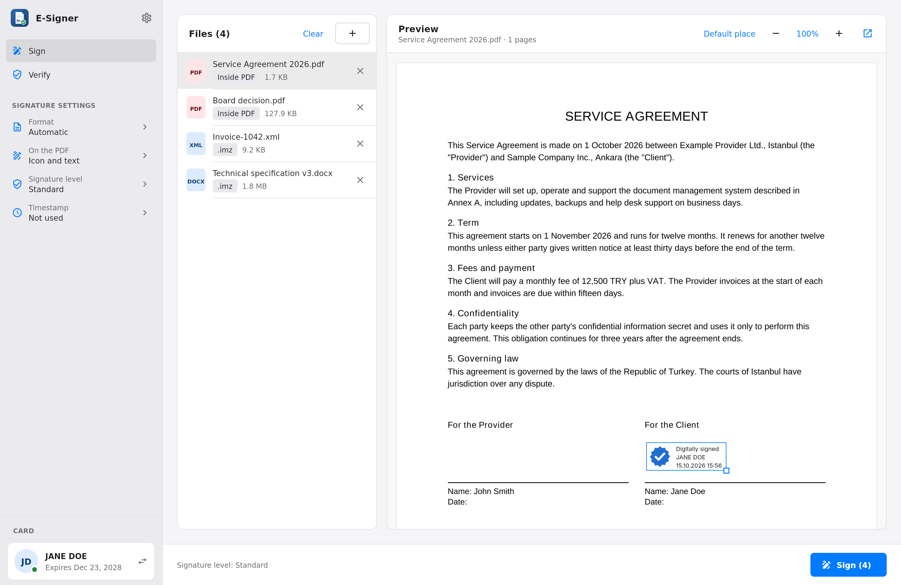
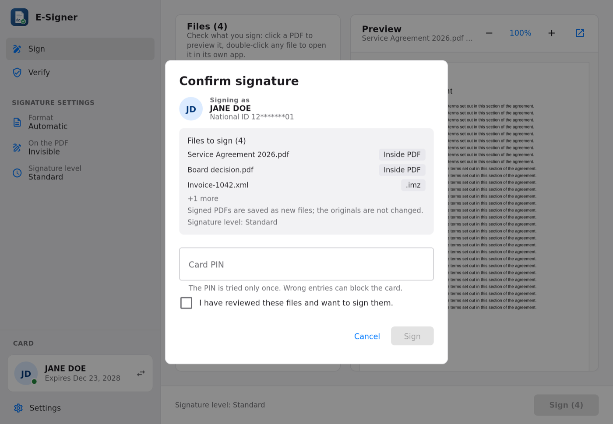
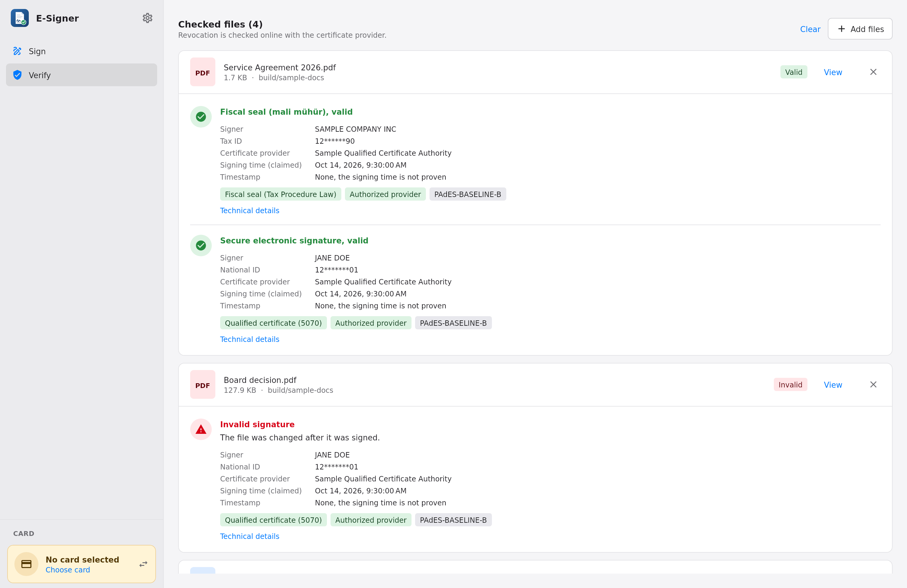

# E-Signer

[Türkçe](README.md)

A desktop app for signing PDFs and other files with Turkish qualified electronic signature cards,
and for verifying signed files. It is developed and tested on macOS (Apple silicon and Intel);
Windows and Linux packages are built too, but they are not tested yet.



## Features

- **Sign with a smart card** over PKCS#11. Tested with AKİS cards, fiscal seal cards are supported too; the card is detected without a PIN,
  and the PIN is asked once per signing run and never retried automatically.
- **PAdES** signatures inside PDFs (existing signatures stay valid) and **CAdES** `.imz` files for any
  other file type.
- **Signature levels:** B-B, B-T with an RFC 3161 time-stamp (including the Kamu SM time-stamp
  authentication), and B-LT with the certificate chains and OCSP/CRL responses embedded.
- **Visible signatures** on PDFs: pick the spot and size in the preview, or let the app find a free one.
- **Review before signing:** a PDF preview and a confirmation that lists what is signed with which certificate.
- **Verify** PAdES and CAdES signatures without a card, against the bundled roots of the Turkish
  qualified trust service providers, including the Law 5070 qualified certificate check and fiscal seals.
- Turkish and English user interface.

| Confirmation | Verification |
| --- | --- |
|  |  |

## Download

Packages are on the [releases page](https://github.com/ayetkin/e-signer/releases):

| System | Package | Status |
| --- | --- | --- |
| macOS, Apple silicon | `E-Signer-<version>-macos-arm64.dmg` | Tested |
| macOS, Intel | `E-Signer-<version>-macos-x64.dmg` | Tested |
| Windows x64 | `.msi` installer or `.zip` | **Not tested** |
| Linux x64 | `.deb` or `.tar.gz` | **Not tested** |

Java is included; you don't need to install it. See [INSTALL.en.md](INSTALL.en.md) for what you need
(card driver, reader) and how to open the app the first time. Changes are listed in
[CHANGELOG.en.md](CHANGELOG.en.md).

## Status

Under active development. Signing and card detection are tested with real AKİS cards on macOS.
**Nothing is tested on Windows or Linux yet:** the packages are built automatically, but it is not
verified that the app starts, detects a card or signs on these systems. Production time-stamp
authorities and fiscal seal cards also need wider testing. If you try it on these systems, please
[report the result](https://github.com/ayetkin/e-signer/issues).

> **Disclaimer.** E-Signer is not a certified product. A signature is qualified because of the
> qualified certificate and the key on your card, not because of this software. Check the signed
> files with the tools your counterparties rely on before using it for anything important.
> The software is provided without any warranty (see [LICENSE](LICENSE)).
>
> The "valid" verdict of the Verify tab has no legal force. It is a technical preliminary check, not an
> official determination. Turkey has no official status like the "qualified validation service" of eIDAS.
> In a dispute, the court has the signature examined by an expert witness; the app's screen is not
> evidence. The same applies to Adobe Reader and other signature tools.

## Building and running

Requirements: JDK 21 and the PKCS#11 driver of your card (for AKİS: `libakisp11.dylib` on macOS,
`akisp11.dll` on Windows, `libakisp11.so` on Linux). The driver path can be changed in
Settings > Card.

```sh
./gradlew :core:test          # core tests, no card needed
./gradlew :app:run            # start the app
```

The tests use software keys and a local time-stamp server, so they need neither a card nor a network.
`./gradlew :app:test` also renders every screen to `app/build/screenshots`.

The repository also has a `Makefile` for building inside Linux containers (Apple `container`),
which packages a self-contained runtime under `dist/`.

## Project layout

- `core/` signing, time-stamping and verification, independent of the UI (EU DSS 6.1).
- `app/` the Compose Multiplatform desktop app.
- `tools/` packaging and screenshot helpers.

## Security

Please report vulnerabilities privately; see [SECURITY.en.md](SECURITY.en.md).

## Contributing

Issues and pull requests are welcome; see [CONTRIBUTING.en.md](CONTRIBUTING.en.md).

## License

E-Signer is licensed under the [GNU Affero General Public License v3.0](LICENSE). Third-party
components keep their own licenses; see [NOTICE](NOTICE).
